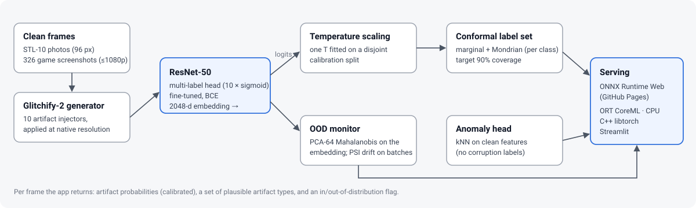
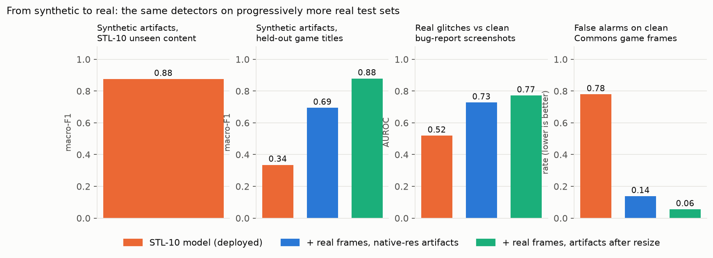
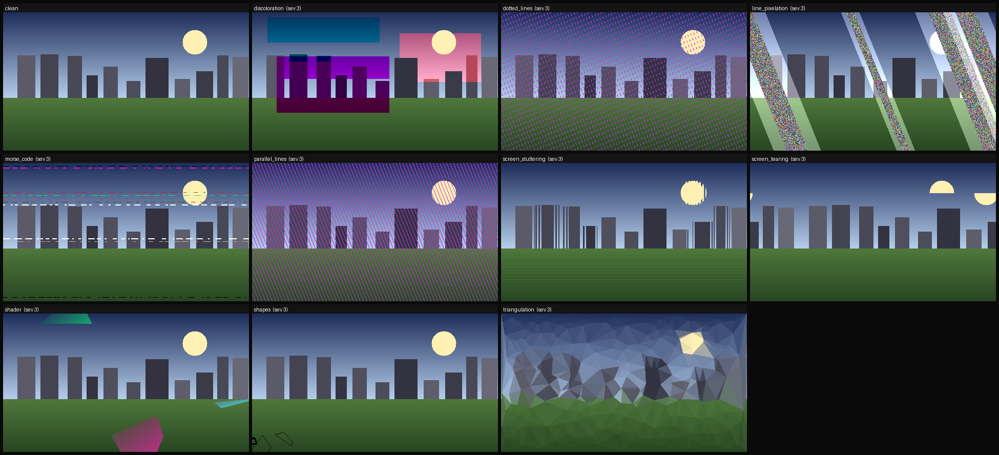
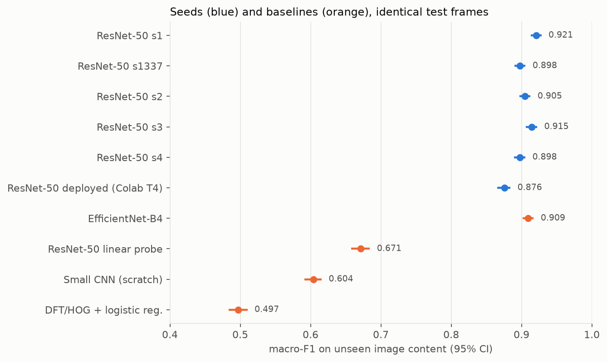
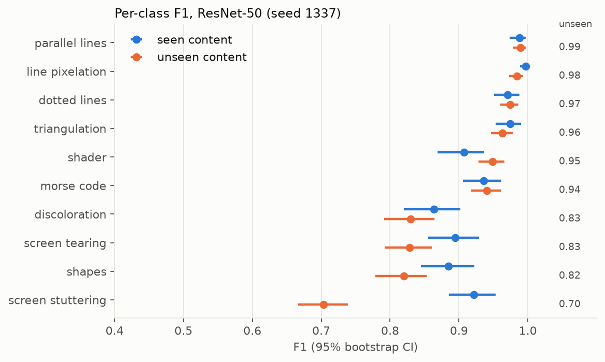
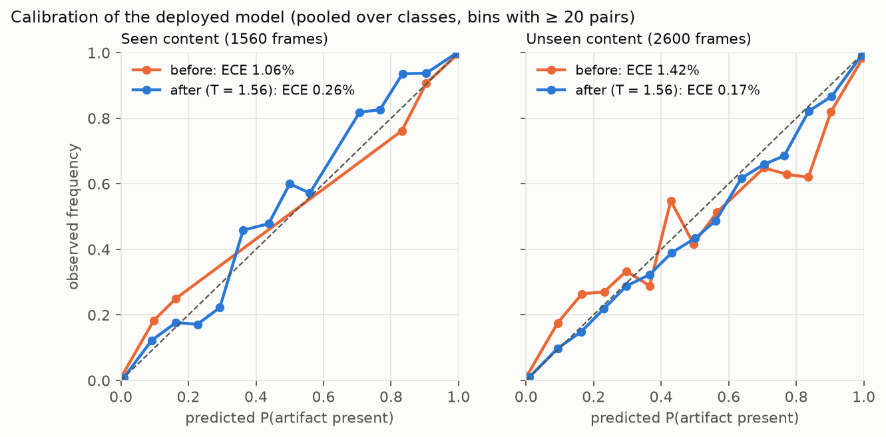
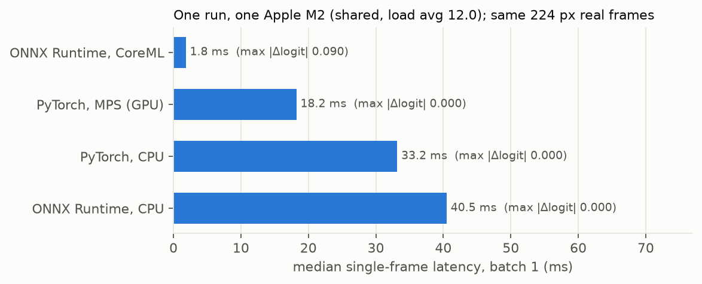

# GPU-CorruptNet

[](https://github.com/tanaymihani/gpu-corruptnet/actions/workflows/ci.yml)
[](https://tanaymihani.github.io/gpu-corruptnet/)
[](LICENSE)


GPU-CorruptNet detects GPU rendering artifacts in a frame (shader errors, stuck-memory
"morse code", tearing, corrupted geometry and textures) and says how sure it is: calibrated
probabilities, a conformal set of plausible artifact types, and an out-of-distribution check.
It is trained on procedurally injected artifacts and then tested, honestly, on real game frames
and on 117 real glitch screenshots from public bug reports.

**[Try it in the browser](https://tanaymihani.github.io/gpu-corruptnet/)**: a ResNet-50 runs
locally through ONNX Runtime Web, so the page never sleeps and your image never leaves it.
The longer write-up is [docs/writeup.md](docs/writeup.md); every table is in
[results/RESULTS.md](results/RESULTS.md).



## Results at a glance

| | |
|---|---|
| Synthetic artifacts, STL-10 photos (5 seeds) | macro-F1 0.935 ± 0.004 seen content, 0.907 ± 0.010 unseen content |
| Calibration (deployed model, T = 1.565) | pooled ECE 1.06% → 0.26%; classwise ECE 1.37% → 1.18% |
| Conformal set, α = 0.1 | 0.905 / 0.895 coverage on corrupted frames (seen / unseen content); per-class (Mondrian) worst class 0.84 / 0.88 |
| Real glitches vs clean bug-report screenshots | AUROC 0.52 → 0.73–0.77 after fine-tuning on real game frames; false alarms on clean frames 78% → 14% |
| Serving, one run on an M2 | 1.8 ms (ONNX Runtime + CoreML) vs 18.2 ms (PyTorch MPS), label sets identical |

What the numbers mean, and what they don't:

- "Unseen content" holds out two STL-10 object classes (ship, truck): new *image content*,
  not new artifact types. New artifact types are tested separately (leave-one-type-out, below).
- The model trained only on synthetic STL-10 data does not transfer to real frames: it flags
  78% of clean game screenshots and separates real glitches from clean screenshots at
  AUROC 0.52 [0.46, 0.57], which is chance. Fine-tuning on 132 real game frames with injected artifacts lifts that to 0.73 [0.68, 0.78] and cuts false alarms on clean Commons frames to 14%, at the cost of recall (0.92 → 0.68 at the 0.5 threshold). Painting artifacts at native resolution versus after the resize made no significant difference on this set (0.73 vs 0.77, overlapping CIs). The VISAPP 2022 detector, trained on real corruption from 50+ games, reports precision 0.989 and recall 0.888, so real captured faults are still what's missing.
- Coverage is reported on corrupted frames only. Clean frames have no true artifacts and are
  covered automatically, which is how an earlier version of this README reported 0.935.



## Data

**Synthetic artifacts.** Ten injectors re-implement the artifact types of AMD/UCLA's
*Glitchify* ([arXiv 2011.15103](https://arxiv.org/abs/2011.15103)). Six are pure NumPy
(`screen_tearing`, `screen_stuttering`, `morse_code`, `discoloration`, `parallel_lines`,
`dotted_lines`); four use OpenCV (`shader`, `shapes`, `triangulation`, `line_pixelation`).
Each injector is deterministic given a seed. One procedural frame under each injector
(`python scripts/make_sanity_grid.py`):



Training frames are corrupted on the fly (30% clean, else 1–2 artifacts at severity 1–5), and
the corruption is re-drawn every epoch. Clean substrates:

- **STL-10** (13,000 labelled 96 px photos). `scripts/fetch_stl10.py` rebuilds the labelled
  binaries from a Hugging Face mirror and checks torchvision's MD5s, because the original host
  refuses CI runners.
- **Real game frames.** 326 free-licence screenshots of 20 open-source games from Wikimedia
  Commons, up to 1920 px (`realdata/clean_frames.csv` records author and licence per file).
  Four titles are held out. Artifacts are painted at the frame's native resolution, then the
  frame is resized to the model input.

**Real glitches.** 117 glitch and 382 clean screenshots from public issues of 19 graphics
projects (DXVK, vkd3d-proton, Proton, RPCS3, PCSX2, PPSSPP, xemu, Flycast, melonDS, Godot, …),
labelled by visual review with a best-fit artifact class and a one-line description. Only URLs
and labels are in the repo (`realdata/real_glitches.csv`); `realdata/fetch.py` downloads them.

## Experiments on free CI runners

Training and evaluation run on GitHub's free CPU runners (this repo is public), dispatched as
suites of a matrix job ([`experiments.yml`](.github/workflows/experiments.yml)). Each job
uploads its logits and labels; [`aggregate_results.py`](scripts/aggregate_results.py) recomputes
every metric from them.

```bash
gh workflow run experiments.yml -f suite=core   # 5 seeds, baselines, deployed re-score, anomaly
gh workflow run experiments.yml -f suite=loto   # retrain without each artifact type in turn
gh workflow run experiments.yml -f suite=real   # real game frames, native vs resize-first artifacts
python scripts/eval_real.py deployed=model.pt   # real glitch screenshots, locally
python scripts/aggregate_results.py && python scripts/make_results_figures.py
```

### Seeds and baselines

Five seeds of the fine-tuned ResNet-50 on identical test frames: macro-F1 **0.935 ± 0.004** on seen content and **0.907 ± 0.010** on unseen content (binary corrupted-vs-clean F1 0.994 / 0.972). The CPU runners hit a 200-minute budget after 7–8 of the planned 12 epochs, and the seeds still beat the deployed 12-epoch checkpoint (0.911 / 0.876), which was trained before the fix that re-draws corruptions every epoch. Baselines on the same frames (unseen content): EfficientNet-B4 0.909 (10 epochs), frozen-backbone linear probe 0.671, a small CNN from scratch 0.604, and Glitchify-style DFT/HOG/colour features with logistic regression 0.497.



### Per-class F1

Bootstrap 95% CIs over test frames. Screen tearing on unseen content is the weak spot.



### Calibration and conformal sets

Temperature scaling (one T fitted on a disjoint 1,560-frame calibration split) fixes the pooled
ECE, but pooled ECE is dominated by the ~90% of (frame, class) pairs that are easy negatives.
Classwise ECE and Brier barely move:

| deployed model | pooled ECE | classwise ECE | Brier |
|---|---|---|---|
| seen content, before → after | 1.06% → 0.26% | 1.37% → 1.18% | 0.0146 → 0.0142 |
| unseen content, before → after | 1.42% → 0.17% | 1.67% → 1.39% | 0.0200 → 0.0194 |



For each frame the conformal procedure returns the artifact types whose calibrated probability
clears a threshold fitted on the calibration split, targeting
`P(all true artifacts ⊆ set) ≥ 0.9`. APS/RAPS are single-label methods, so I use a
full-inclusion split-conformal construction ([`calibration.py`](src/gpu_corruptnet/calibration.py)).
Marginal coverage on corrupted frames is 0.905 (seen) / 0.895 (unseen), but per class it
drops to 0.78 for shapes and 0.82 for screen tearing on unseen content. A Mondrian set (one
threshold per class, [`evaluation.py`](src/gpu_corruptnet/evaluation.py)) lifts the worst class
to 0.84 / 0.88 for slightly larger sets.

```bash
python scripts/calibrate.py runs/preds_resnet50_<stamp>.npz --alpha 0.1
```

### Artifact types the model never saw

Retraining the classifier ten times, each time without one artifact type (6-epoch budget), and checking whether frames whose only artifact is the held-out type are still flagged as corrupted: triangulation (1.00), dotted lines (0.99), parallel lines (0.97), morse code (0.85) and line pixelation (0.84) are caught without ever being seen; shader (0.69), discoloration (0.55) and screen stuttering (0.45) partly; shapes (0.14) and screen tearing (0.01) almost never. With the type in training, recall is 0.93–1.00 for every type.

The unsupervised anomaly head (kNN distance to clean-frame features of an ImageNet ResNet-50,
a lightweight PatchCore) never sees a corruption label. Overall AUROC is 0.835 on the full
seen-content split, ranging from 0.57 (shapes) and 0.66 (discoloration) to 0.99+ (dotted
lines, parallel lines, triangulation).

### Out-of-distribution checks

`DriftMonitor` computes per-feature PSI for batch drift, and the OOD score is a PCA-64
Mahalanobis distance on the classifier's own 2048-d embedding, referenced to training frames.
It separates clean from corrupted frames (AUROC 0.84) but barely notices unseen content
(0.60). It also flags **none** of the real game frames, even though the synthetic-only model
false-alarms on most of them: real frames embed next to the corrupted training frames. An OOD
reference that contains the positive class can't catch a shift that makes everything look
positive.

### Latency

One run, one Apple M2 (shared with other jobs, so absolute numbers are pessimistic), batch 1,
224 px real frames, each backend checked against PyTorch-CPU logits on the same frames
([`latency_parity.py`](scripts/latency_parity.py), [`results/latency_parity.json`](results/latency_parity.json)).
The Colab notebook has a cell that adds the T4 CUDA and TensorRT-FP16 rows.



## Serving

- **In-browser demo** ([`web/`](web/)): ONNX Runtime Web (WASM). The Pages workflow exports
  the released checkpoint with [`export_web.py`](scripts/export_web.py): logits plus embedding
  outputs, weights stored as fp16 (47 MB) and cast to fp32 at load, max logit difference 0.005
  vs PyTorch.
- **C++ / libtorch** ([`cpp/`](cpp/)): loads a TorchScript export, 21.7 ms vs 30.7 ms per frame
  in Python on CPU (~1.4x) by dropping interpreter overhead. On ROCm the same code targets AMD
  GPUs, since `torch::kCUDA` maps to HIP. See [`cpp/README.md`](cpp/README.md).
- **Streamlit** (`streamlit run streamlit_app.py`): upload a frame, inject a corruption, see
  detections, calibrated confidence, the conformal set and an OOD score.
- **Hugging Face**: [`scripts/publish_hf.py`](scripts/publish_hf.py) packages safetensors, a
  config (classes, T, τ) and the [model card](hf/README.md).

## Prior work

- Davarmanesh et al., *Automating Artifact Detection in Video Games* (AMD + UCLA IPAM, 2020,
  [arXiv 2011.15103](https://arxiv.org/abs/2011.15103)): the Glitchify taxonomy; classical
  features, 84% on seen games and 69% on unseen.
- Chan Chee, Pandit and Kiehn, *Detecting Corruption in Real Video Game Graphics using Deep
  Convolutional Neural Networks* (University of Toronto + AMD, VISAPP 2022,
  [doi:10.5220/0010788900003124](https://doi.org/10.5220/0010788900003124)): EfficientNet on real
  corruption from 50+ games, precision 0.989, recall 0.888. The closest work and the real-frame bar.
- Ling, Tollmar and Gisslén, *Using Deep Convolutional Neural Networks to Detect Rendered Glitches
  in Video Games* (EA SEED, AIIDE 2020, [doi:10.1609/aiide.v16i1.7409](https://doi.org/10.1609/aiide.v16i1.7409)).
- Chen et al., *GLIB: Towards Automated Test Oracle for Graphically-Rich Applications*
  (NetEase + UT Dallas, ESEC/FSE 2021, [arXiv 2106.10507](https://arxiv.org/abs/2106.10507)).
- Taesiri, Feng, Bezemer and Nguyen, *GlitchBench: Can Large Multimodal Models Detect Video Game
  Glitches?* (CVPR 2024, [glitchbench.github.io](https://glitchbench.github.io/)).

What this project adds is the reliability layer (calibration, conformal sets evaluated per
class and on corrupted frames only, embedding OOD) and an honest synthetic-to-real test.
Not done: a cross-generator test against AMD's original Glitchify code, which has no licence.

## Quickstart

```bash
python -m venv .venv && source .venv/bin/activate
pip install torch torchvision --index-url https://download.pytorch.org/whl/cpu
pip install -e ".[test]"
pytest -q
```

```python
from gpu_corruptnet.corruptions import apply, available
from gpu_corruptnet.data import make_demo_frame

frame = make_demo_frame()                      # or your own (H, W, 3) uint8 RGB frame
print(available())                             # implemented injectors
glitched = apply("screen_tearing", frame, severity=4, rng=0)
```

Train locally (`--smoke` for a minute-long check) or on a free Colab T4 with
[`notebooks/train_colab.ipynb`](notebooks/train_colab.ipynb):

```bash
python scripts/train_classifier.py --arch resnet50 --epochs 12 --img-size 224 \
    --batch-size 64 --lr 1e-4 --no-freeze
python scripts/train_classifier.py --substrate real --init-ckpt model.pt ...   # real frames
```

## Also in the repo

- **Metadata stores** (`db/`): run and metric records in PostgreSQL (SQLAlchemy; SQLite in
  tests), per-image annotations in MongoDB (`mongomock` in tests). `docker compose up -d` starts both.
- **Source-code analysis** (`scripts/code_report.py`): AST cyclomatic complexity, docstring
  coverage and hotspots for this codebase.
- **Benchmarks** (`scripts/benchmark.py`, `export_benchmark.py`): warmup, synchronised timing,
  p50/p95/p99 and batch sweeps; earlier JSONs are in `results/earlier_benchmarks/`.

## Layout

```
src/gpu_corruptnet/
  corruptions/    # injector registry and the 10 artifact types
  data/           # STL-10 and real-frame sources, on-the-fly corruption dataset
  models/         # ResNet-50 / EfficientNet-B4 / small CNN multi-label classifiers
  train.py        # training loop, seen/unseen eval, logits + embeddings to runs/
  calibration.py  # temperature scaling, ECE, full-inclusion conformal sets
  evaluation.py   # bootstrap CIs, classwise ECE, Brier, Mondrian conformal, embedding OOD
  anomaly.py      # label-free kNN anomaly head
  drift.py        # PSI drift + Mahalanobis OOD monitor
  export.py, bench.py, serve.py, db/, codeanalysis.py
realdata/         # real-frame and real-glitch manifests + fetch / collection scripts
scripts/          # train, evaluate, aggregate, figures, export, benchmarks, demo
results/          # published run artifacts and RESULTS.md
web/              # in-browser demo (GitHub Pages)
hf/               # Hugging Face model card
cpp/              # C++ / libtorch inference path
docs/writeup.md   # technical note
```

## License

MIT. Real-frame images are not redistributed here; the manifests record each file's source
and licence.
